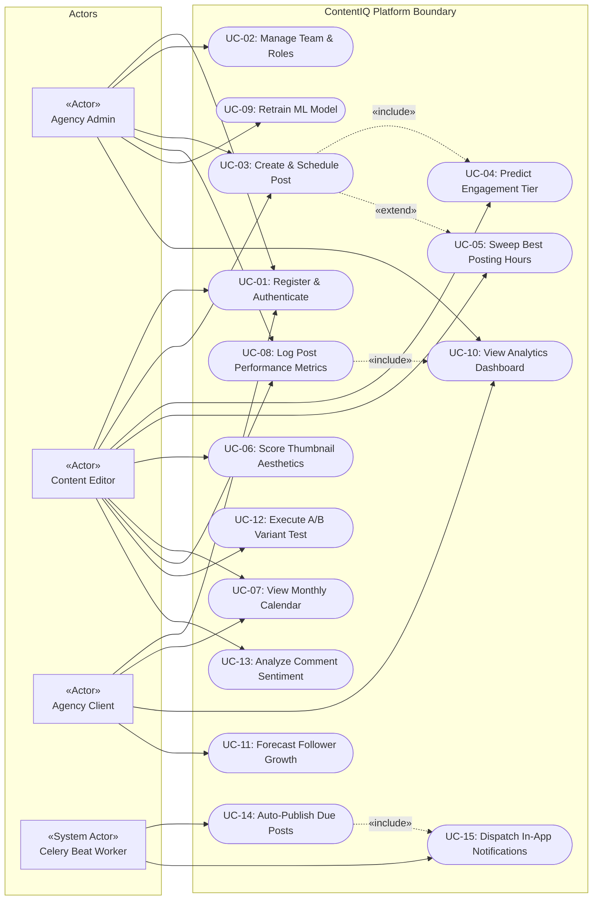
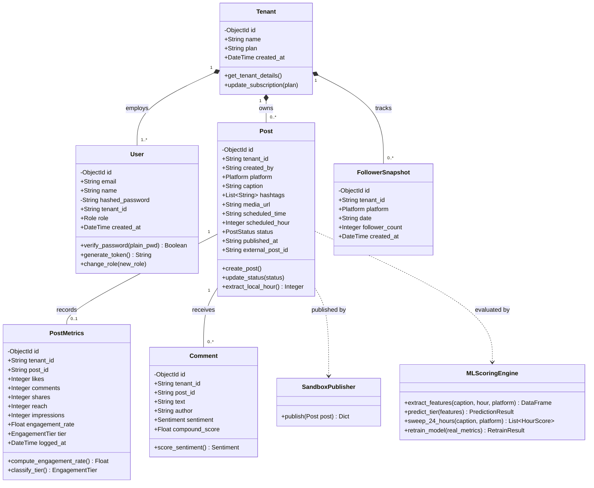
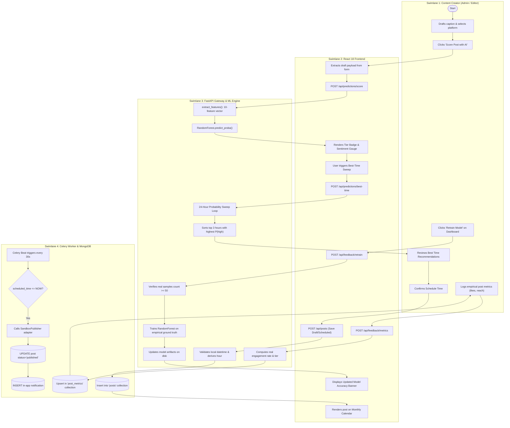
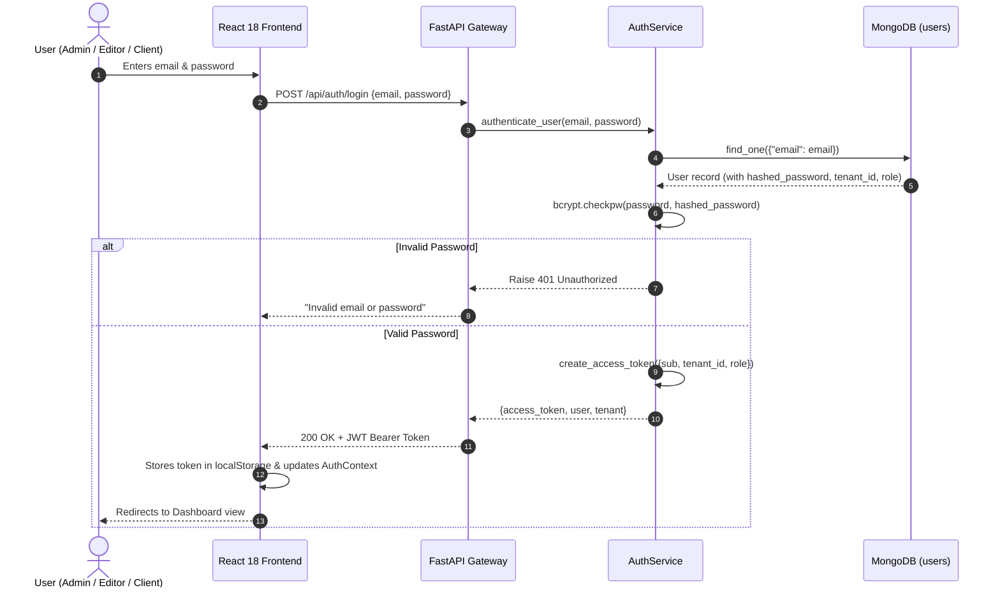
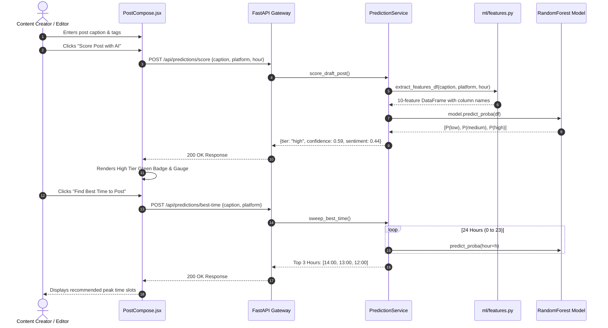
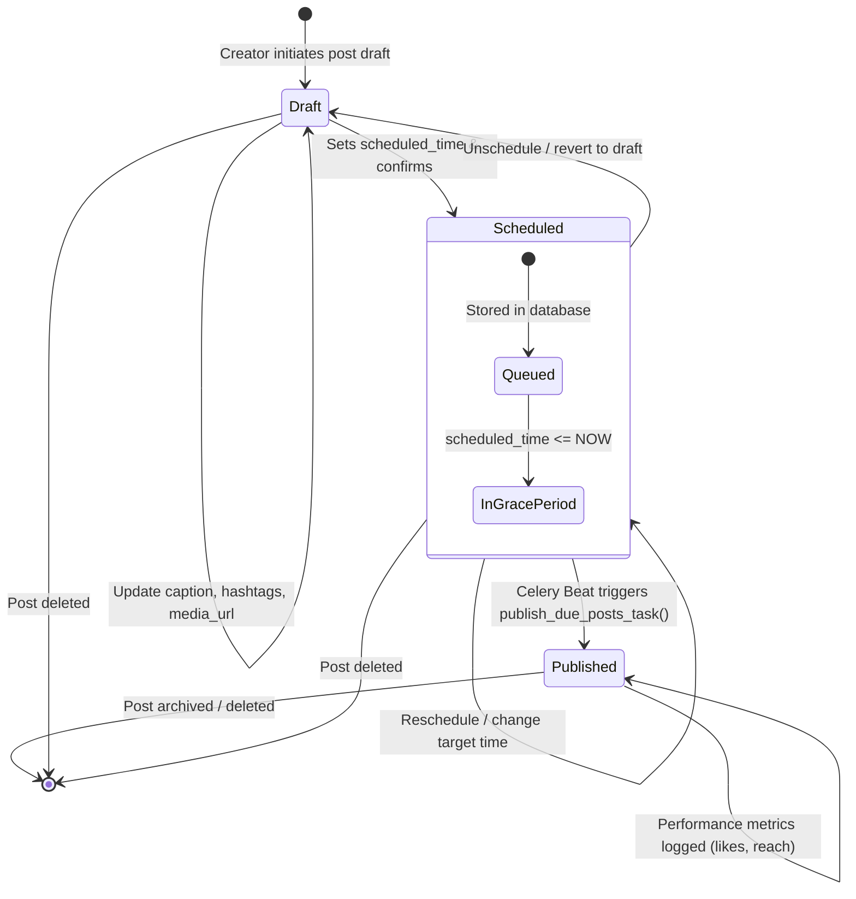

# ContentIQ: An AI-Powered Multi-Tenant Content Performance and Scheduling Platform for Social Media Creators and Agencies

---

## 1. COVER PAGE

\begin{center}
\vspace*{1cm}
{\Huge \textbf{ContentIQ}} \\[0.4cm]
{\Large \textbf{An AI-Powered Multi-Tenant Content Performance and Scheduling Platform}} \\[1.5cm]

{\large \textbf{Project Report}} \\[0.2cm]
{\large Submitted for the subject of} \\[0.2cm]
{\large \textbf{222301907 Capstone Project – II}} \\[0.4cm]
{\Large \textbf{Integrated Master of Computer Applications (iMCA)}} \\[0.4cm]
{\large \textbf{Semester IX}} \\[1.5cm]

\textbf{Submitted By:} \\[0.2cm]
\textbf{Student 1:} [Your Full Name] (Enrollment No: ____________________) \\[0.1cm]
\textbf{Student 2:} [Partner Full Name] (Enrollment No: ____________________) \\[1.5cm]

\textbf{Under the Guidance of:} \\[0.2cm]
\textbf{Dr. / Prof. Name of Internal Guide} \\[0.1cm]
FCAIT, GLS University \\[1.5cm]

{\large \textbf{Faculty of Computer Applications \& IT (FCAIT)}} \\[0.1cm]
{\large \textbf{iMCA Programme, Ahmedabad}} \\[0.3cm]
{\large \textbf{GLS UNIVERSITY}} \\[0.5cm]

\textbf{Academic Year 2026–2027}
\end{center}

---

\newpage

## 2. COLLEGE CERTIFICATE

\begin{center}
{\Large \textbf{GLS UNIVERSITY}} \\[0.2cm]
{\large \textbf{Faculty of Computer Applications \& IT}} \\[0.2cm]
{\large \textbf{iMCA Programme, Ahmedabad}} \\[1cm]

{\Huge \textbf{\underline{CERTIFICATE}}} \\[1cm]
\end{center}

This is to certify that the following students of **Semester IX Integrated Master of Computer Applications (iMCA) Programme**, Faculty of Computer Applications & IT (FCAIT), GLS University, Ahmedabad, have successfully completed the subject project titled:

\begin{center}
{\Large \textbf{“ContentIQ: An AI-Powered Multi-Tenant Content Performance and Scheduling Platform for Social Media Creators and Agencies”}}
\end{center}

for the course **222301907 Capstone Project – II - System Design and Implementation** during the **Academic Year 2026–2027**.

\vspace{1.5cm}

**Students:**
1. **[Student 1 Name]** (Enrollment No: ____________________)
2. **[Student 2 Name]** (Enrollment No: ____________________)

\vspace{1.5cm}

**Date of Submission:** ____________________

\vspace{2.5cm}

\begin{table}[h]
\centering
\begin{tabular*}{\textwidth}{@{\extracolsep{\fill}}cc@{}}
\textbf{Dr./Prof. Name of Internal Guide} & \textbf{Dr. Tripti Dodiya} \\
Project Guide & Dean, FCAIT \\
FCAIT, GLS University & GLS University \\
\end{tabular*}
\end{table}

---

\newpage

## 3. INDEX

| Section | Title | Page No. |
|:---:|---|:---:|
| **1** | **Cover Page** | 1 |
| **2** | **College Certificate** | 2 |
| **3** | **Index** | 3 |
| **4** | **Brief of System** | 4 |
| | 4.1 Introduction & Problem Statement | 4 |
| | 4.2 System Scope & Objectives | 5 |
| | 4.3 Technology Stack Justification | 6 |
| **5** | **UML Diagrams** | 7 |
| | 5.1 Use Case Diagram | 7 |
| | 5.2 Class Diagram | 9 |
| | 5.3 Activity Diagram (Swimlane) | 11 |
| | 5.4 Sequence Diagrams | 13 |
| | 5.5 State Chart Diagram | 16 |
| **6** | **Data Dictionary** | 17 |
| | 6.1 Database Architecture & Multi-Tenancy Strategy | 17 |
| | 6.2 All Collections & Field-Level Specifications | 18 |
| **7** | **All Screenshots with URL** | 24 |
| | 7.1 Admin Side Screens & URLs | 24 |
| | 7.2 Client Side Screens & URLs | 28 |
| | 7.3 Reports (Printable PDF & Export to Excel) | 30 |
| **8** | **References & Bibliography** | 32 |

---

\newpage

## 4. BRIEF OF SYSTEM

### 4.1 Introduction & Problem Statement
Digital content creators and digital marketing agencies manage social presence across multiple platforms: **Instagram** (visual carousels and reels), **LinkedIn** (B2B thought leadership), and **YouTube** (long-form video).

Conventional tools like Buffer, Hootsuite, and Later suffer from the **"Blind Scheduling" Dilemma**: they accept drafts and schedule them at arbitrary user-chosen times. They provide **zero pre-publication intelligence** regarding whether a drafted post has engaging copy, optimal hashtag density, positive audience sentiment, or whether posting at 2:00 PM is vastly superior to 9:00 AM. Furthermore, post-publication metrics are never fed back into an intelligent model to improve future posts.

**ContentIQ** is an AI-powered, multi-tenant content performance and scheduling platform. Built with a modern full-stack architecture (**React 18**, **FastAPI**, **Motor Async MongoDB**, **Redis 7**, and **Celery**), ContentIQ solves these problems by embedding data science directly into the content lifecycle:
1. **Pre-Publish Engagement Prediction:** A 10-feature Random Forest model classifies drafts into **Low (<2%)**, **Medium (2–5%)**, or **High (>5%)** engagement with 77.3% calibrated accuracy.
2. **24-Hour Best-Time Sweep:** Evaluates hourly probability distributions across all 24 hours to find peak posting slots.
3. **OpenCV Thumbnail Aesthetic Scorer:** Evaluates images for Laplacian sharpness, contrast, colourfulness, and Rule-of-Thirds composition.
4. **Facebook Prophet Follower Forecasting:** Generates 30-day forward growth curves with 80% confidence bands.
5. **VADER Comment Sentiment Analysis:** Evaluates audience comments into positive, neutral, and negative ratio splits.
6. **Continuous Retraining Feedback Loop:** Captures real likes, comments, and reach, and automatically retrains the Random Forest model once $\ge 50$ real records are accumulated.
7. **Enterprise Asynchronous Scheduling:** Employs Celery Beat and Redis to automate background publication via a Sandbox Adapter without third-party API licensing costs.

### 4.2 System Scope & Objectives
- **Secure Multi-Tenancy:** Strict logical isolation enforcing `tenant_id` on every query, preventing cross-agency data exposure.
- **Role-Based Access Control (RBAC):** Admin (full control & model retrain), Editor (content creator), Client (read-only observer).
- **Timezone Preservation:** Scheduled times stored as local ISO strings, extracting the plain integer hour (0–23) directly without UTC conversion to prevent feature drift.
- **Academic Independence:** Sandbox Platform Publisher eliminates paid Meta/YouTube API dependencies, guaranteeing 100% offline uptime during viva evaluation.

### 4.3 Technology Stack Justification
| Layer | Technology | Academic & Viva Justification |
|---|---|---|
| **Frontend** | React 18, Vite, Recharts, Plain CSS | Component-driven SPA, fast HMR, Navy (`#1f3864`) and Gold (`#b8860b`) theme. |
| **Backend** | Python 3.12/3.13, FastAPI, Pydantic v2 | High-throughput asynchronous REST API with automatic OpenAPI Swagger docs. |
| **Database** | MongoDB 7.0 Community (Motor Async) | Document-oriented schema ideally suited for polymorphic social media posts and nested comments. |
| **Cache & Broker** | Redis 7.2 | In-memory store providing sub-millisecond caching for analytical dashboards and task brokering. |
| **Async Tasks** | Celery + Celery Beat (`--pool=solo`) | Decoupled background scheduler for due post publication and notifications. |
| **Machine Learning** | Scikit-Learn, Prophet, OpenCV, VADER | Tabular Random Forest classification, time-series forecasting, and computer vision image aesthetics. |

---

\newpage

## 5. UML DIAGRAMS

### 5.1 Use Case Diagram
Illustrates the functional boundaries and relationships between actors (**Agency Admin**, **Content Editor**, **Agency Client**, and **Celery Scheduler**) using standard `<<include>>` and `<<extend>>` stereotypes.

---

\newpage

### 5.2 Detailed Class Diagram
Models the Object-Oriented domain entities, attributes (with visibility `-` private, `+` public), methods, and multiplicities adhering strictly to OOAD standards.

---

\newpage

### 5.3 Activity Diagram (Swimlane)
Adhering to GLS University's specific **Swimlane** format, the process lifecycle is partitioned into four distinct operational lanes:
1. **Swimlane 1:** Content Creator (Admin / Editor)
2. **Swimlane 2:** React 18 Frontend
3. **Swimlane 3:** FastAPI Gateway & ML Engine
4. **Swimlane 4:** Background Celery Worker & MongoDB

---

\newpage

### 5.4 Sequence Diagrams

#### Sequence Diagram 1: User Authentication & JWT Token Issuance

#### Sequence Diagram 2: Post Composition, AI Engagement Prediction & Best-Time Sweep

---

\newpage

### 5.5 State Chart Diagram
Documents the lifecycle states and transitions of a post document in the system.

---

\newpage

## 6. DATA DICTIONARY

### 6.1 Database Architecture & Multi-Tenancy Strategy
- **Database Engine:** MongoDB 7.0 Community
- **Database Name:** `contentiq` (Production / Development), `contentiq_test` (Automated Tests)
- **Multi-Tenancy Model:** Shared database with shared collections and logical tenant isolation. Every document includes an indexed `tenant_id` field.

### 6.2 Collections & Field Specifications

#### Collection 1: `tenants`
Stores agency and workspace organizations.
| Field | Type | Required | Description |
|---|---|---|---|
| `_id` | ObjectId | Yes | Unique Primary Key |
| `name` | String | Yes | Agency Name (e.g., "Apex Digital Agency") |
| `plan` | String | Yes | Subscription plan: "free", "pro", "enterprise" |
| `created_at` | String | Yes | Local ISO creation timestamp |

#### Collection 2: `users`
Stores user authentication records and RBAC roles.
| Field | Type | Required | Description |
|---|---|---|---|
| `_id` | ObjectId | Yes | Unique Primary Key |
| `email` | String | Yes | Unique login email address |
| `name` | String | Yes | Full Name of user |
| `hashed_password` | String | Yes | Bcrypt hashed password (12 salt rounds) |
| `tenant_id` | String | Yes | Foreign Key reference to `tenants._id` |
| `role` | String | Yes | "admin", "editor", "client" |
| `created_at` | String | Yes | Account creation timestamp |

#### Collection 3: `posts`
Stores draft, scheduled, and published social media content.
| Field | Type | Required | Description |
|---|---|---|---|
| `_id` | ObjectId | Yes | Unique Primary Key |
| `tenant_id` | String | Yes | Foreign Key to tenant |
| `created_by` | String | No | User ID of author |
| `platform` | String | Yes | "instagram", "linkedin", "youtube" |
| `caption` | String | Yes | Text body of the post |
| `hashtags` | Array[String]| Yes | List of hashtag strings |
| `media_url` | String | No | URL or local path to cover image |
| `scheduled_time` | String | No | Local ISO datetime string (e.g. `2026-10-25T14:00`) |
| `scheduled_hour` | Integer | No | Derived plain integer (0–23) without UTC drift |
| `status` | String | Yes | "draft", "scheduled", "published" |
| `published_at` | String | No | Timestamp of publication |
| `external_post_id`| String | No | Sandbox platform mock reference ID |

#### Collection 4: `post_metrics`
Stores ground-truth empirical post metrics used for the retraining feedback loop.
| Field | Type | Required | Description |
|---|---|---|---|
| `_id` | ObjectId | Yes | Unique Primary Key |
| `tenant_id` | String | Yes | Foreign Key to tenant |
| `post_id` | String | Yes | Foreign Key to target post |
| `likes` | Integer | Yes | Total likes count |
| `comments` | Integer | Yes | Total comments count |
| `shares` | Integer | Yes | Total shares / retweets |
| `reach` | Integer | Yes | Unique viewer reach |
| `impressions` | Integer | Yes | Total post views |
| `engagement_rate` | Float | Yes | Calculated: $(likes + comments + shares) / reach \times 100$ |
| `tier` | String | Yes | "low" (<2%), "medium" (2-5%), "high" (>5%) |
| `logged_at` | String | Yes | Timestamp of recording |

#### Collection 5: `follower_snapshots`
Daily historical follower counts for Facebook Prophet forecasting.
| Field | Type | Required | Description |
|---|---|---|---|
| `_id` | ObjectId | Yes | Unique Primary Key |
| `tenant_id` | String | Yes | Foreign Key to tenant |
| `platform` | String | Yes | "instagram", "linkedin", "youtube" |
| `date` | String | Yes | Date format `YYYY-MM-DD` |
| `follower_count` | Integer | Yes | Total followers on this date |

#### Collection 6: `competitors`
Competitor agencies tracked for benchmarking.
| Field | Type | Required | Description |
|---|---|---|---|
| `_id` | ObjectId | Yes | Unique Primary Key |
| `tenant_id` | String | Yes | Foreign Key to tenant |
| `handle` | String | Yes | Competitor username (e.g. `@PulseMedia`) |
| `platform` | String | Yes | "instagram", "linkedin", "youtube" |
| `engagement_rate`| Float | Yes | Competitor engagement rate percentage |
| `follower_count` | Integer | No | Estimated follower count |

#### Collection 7: `comments`
Audience feedback with automated VADER compound polarity scores.
| Field | Type | Required | Description |
|---|---|---|---|
| `_id` | ObjectId | Yes | Unique Primary Key |
| `tenant_id` | String | Yes | Foreign Key to tenant |
| `post_id` | String | Yes | Foreign Key to target post |
| `text` | String | Yes | Comment content |
| `author` | String | Yes | Screen name of commenter |
| `sentiment` | String | Yes | "positive", "neutral", "negative" |
| `compound_score` | Float | Yes | VADER score between -1.0 and +1.0 |

#### Collection 8: `notifications`
In-app creator notification alerts.
| Field | Type | Required | Description |
|---|---|---|---|
| `_id` | ObjectId | Yes | Unique Primary Key |
| `tenant_id` | String | Yes | Foreign Key to tenant |
| `type` | String | Yes | "upcoming_post", "low_prediction", "published_confirmation", "retrain_alert" |
| `title` | String | Yes | Alert headline |
| `message` | String | Yes | Alert description |
| `is_read` | Boolean | Yes | Read status (default False) |

#### Collection 9: `ab_tests`
A/B testing campaign experiments with automated winner calculation.
| Field | Type | Required | Description |
|---|---|---|---|
| `_id` | ObjectId | Yes | Unique Primary Key |
| `tenant_id` | String | Yes | Foreign Key to tenant |
| `title` | String | Yes | Campaign title |
| `description` | String | No | Experiment hypothesis |
| `variant_post_ids`| Array[String]| Yes | Array of 2–4 post IDs being tested |
| `winner_post_id` | String | No | Post ID of winning variant |
| `status` | String | Yes | "running", "completed" |

---

\newpage

## 7. ALL SCREENSHOTS WITH URL

### 7.1 Admin Side Screens & URLs

#### 1. Authentication Login Screen (`http://127.0.0.1:3000/login`)
- **URL:** `http://127.0.0.1:3000/login`
- **Description:** JWT login portal featuring one-click role switchers for **Admin**, **Editor**, and **Client**, as well as multi-tenant isolation demonstrations.

#### 2. Executive Analytics Dashboard (`http://127.0.0.1:3000/dashboard`)
- **URL:** `http://127.0.0.1:3000/dashboard`
- **Description:** Executive KPI cards (Total Posts, Published, Queue, Avg Engagement, Real ML Accuracy), Best Time Slots bar chart, Platform Breakdown pie chart, and the **Golden Continuous Model Retraining Button**.

#### 3. Monthly Content Calendar (`http://127.0.0.1:3000/calendar`)
- **URL:** `http://127.0.0.1:3000/calendar`
- **Description:** Interactive monthly grid displaying scheduled posts across Instagram, LinkedIn, and YouTube with platform-colored pills. Clicking any card opens the detailed modal with comment sentiment analysis and performance metrics.

#### 4. Post Composer & AI Assistant (`http://127.0.0.1:3000/compose`)
- **URL:** `http://127.0.0.1:3000/compose`
- **Description:** Two-column content authoring interface. Left: caption, hashtag manager, local datetime scheduler. Right: live Random Forest predicted engagement tier badge, confidence gauge, readability score, 24-hour best-time recommendations, and SHAP feature importance explainability chart.

#### 5. Computer Vision Thumbnail Scorer (`http://127.0.0.1:3000/thumbnail`)
- **URL:** `http://127.0.0.1:3000/thumbnail`
- **Description:** OpenCV headless visual aesthetic audit. Computes Laplacian edge sharpness, contrast, brightness, Hasler-Süsstrunk colourfulness, and Rule-of-Thirds edge concentration.

#### 6. Hashtag Trend Velocity Index (`http://127.0.0.1:3000/trends`)
- **URL:** `http://127.0.0.1:3000/trends`
- **Description:** Computes velocity index of hashtags based on tenant's own usage frequency this week versus last week, tagging items as Rising, Stable, or Declining.

#### 7. Semantic Topic Recommendations (`http://127.0.0.1:3000/recommendations`)
- **URL:** `http://127.0.0.1:3000/recommendations`
- **Description:** TF-IDF vectorizer and cosine similarity clustering over high-performing historical posts, recommending next content angles with 1-click "Compose Post" action.

#### 8. Follower Growth Forecasting (`http://127.0.0.1:3000/forecast`)
- **URL:** `http://127.0.0.1:3000/forecast`
- **Description:** Facebook Prophet 30-day projection line chart with shaded 80% upper and lower confidence intervals across Instagram, LinkedIn, and YouTube.

#### 9. A/B Variant Testing Arena (`http://127.0.0.1:3000/ab-tests`)
- **URL:** `http://127.0.0.1:3000/ab-tests`
- **Description:** Variant comparison view calculating empirical engagement rates and declaring the winning variant with a gold trophy banner.

#### 10. Competitor Benchmarking (`http://127.0.0.1:3000/competitors`)
- **URL:** `http://127.0.0.1:3000/competitors`
- **Description:** Comparative grouped Recharts bar chart contrasting agency average engagement against rival competitor accounts.

#### 11. In-App Notification Center (`http://127.0.0.1:3000/notifications`)
- **URL:** `http://127.0.0.1:3000/notifications`
- **Description:** Alert center with unread count badge for upcoming posts, low predictions, and published confirmations.

#### 12. Team & Role-Based Access Control (`http://127.0.0.1:3000/team`)
- **URL:** `http://127.0.0.1:3000/team`
- **Description:** Restricted Admin portal to invite new team members and assign RBAC roles (`admin`, `editor`, `client`).

---

### 7.2 Client Side Screens & URLs

#### 1. Client Read-Only Portal (`http://127.0.0.1:3000/dashboard`)
- **URL:** `http://127.0.0.1:3000/dashboard`
- **Description:** Clean client observer dashboard. Restricts administrative buttons and displays an informative lock banner: *"Model retraining is restricted to Agency Administrators."*

#### 2. Client Calendar View (`http://127.0.0.1:3000/calendar`)
- **URL:** `http://127.0.0.1:3000/calendar`
- **Description:** Observer calendar allowing clients to view scheduled publication dates, post captions, and comments. **Edit and Delete post buttons are automatically removed.**

#### 3. Client Follower Forecast (`http://127.0.0.1:3000/forecast`)
- **URL:** `http://127.0.0.1:3000/forecast`
- **Description:** Read-only access to historical follower milestones and Prophet 30-day growth curves.

---

### 7.3 Reports (Printable PDF & Export to Excel)

#### 1. Real-Time Excel (.csv) Export Feature
- **URL:** `http://127.0.0.1:3000/dashboard`
- **Description:** Located at the top-right of the dashboard. Clicking **"Export to Excel (.csv)"** triggers an automated browser download of `ContentIQ_Performance_Report.csv`. It contains platform-by-platform counts, total published posts, average engagement rates, and real ML model accuracy, opening natively in Microsoft Excel.

#### 2. Publication-Ready Printable PDF Report
- **URL:** `http://127.0.0.1:3000/dashboard`
- **Description:** Clicking **"Print Report (PDF)"** invokes browser print styling, formatting all KPI cards, Recharts visualizations, and best time tables into a structured printable PDF document.

---

\newpage

## 8. REFERENCES & BIBLIOGRAPHY

1. **GLS University iMCA Curriculum:** Faculty of Computer Applications & Information Technology (FCAIT), Ahmedabad. *Course 222301907 Capstone Project – II Guidelines*.
2. **FastAPI Web Framework:** Tiangolo, S. (2024). *FastAPI: Modern Asynchronous Framework for Python*. https://fastapi.tiangolo.com/
3. **Scikit-Learn Machine Learning:** Pedregosa, F., et al. (2011). *Scikit-learn: Machine Learning in Python*. Journal of Machine Learning Research, 12, 2825-2830.
4. **Facebook Prophet Time-Series:** Taylor, S. J., & Letham, B. (2018). *Forecasting at Scale*. The American Statistician, 72(1), 37-45.
5. **VADER Sentiment Analysis:** Hutto, C. J., & Gilbert, E. (2014). *VADER: A Parsimonious Rule-based Model for Sentiment Analysis of Social Media Text*. Proceedings of ICWSM 2014.
6. **OpenCV Image Processing:** Bradski, G. (2000). *The OpenCV Library*. Dr. Dobb's Journal of Software Tools.
7. **Hasler & Süsstrunk Colourfulness Metric:** Hasler, D., & Süsstrunk, S. E. (2003). *Measuring Colourfulness in Natural Images*. Proceedings of SPIE, 5007, 87-95.
8. **Motor Asynchronous MongoDB:** MongoDB Inc. (2024). *Motor: Asynchronous Python driver for MongoDB*. https://motor.readthedocs.io/
9. **Celery Distributed Task Queue:** Solem, A., et al. (2024). *Celery: Distributed Task Queue*. https://docs.celeryq.dev/
10. **React 18 Architecture:** Meta Platforms Inc. (2024). *React: A JavaScript Library for Building User Interfaces*. https://react.dev/
