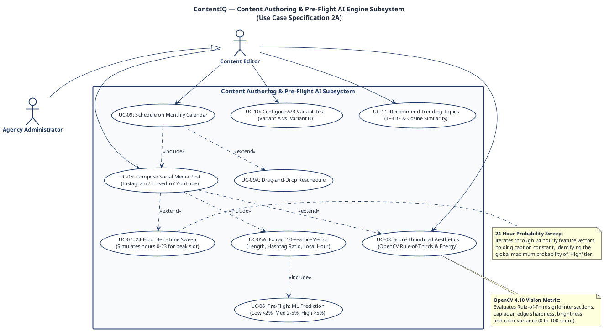
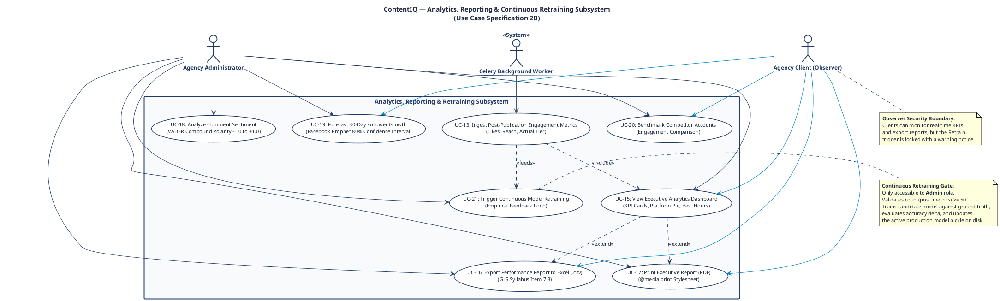
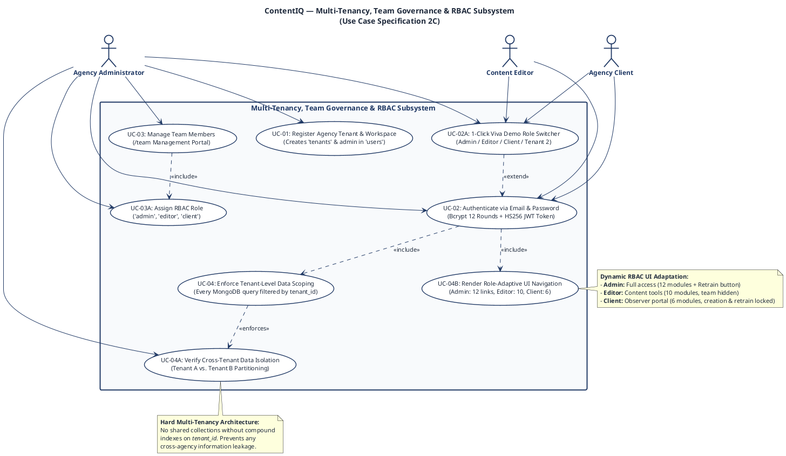

# ContentIQ: Complete PlantUML Use Case Diagrams Specification
**GLS UNIVERSITY — Faculty of Computer Applications & Information Technology (FCAIT)**  
**Programme:** Integrated Master of Computer Applications (iMCA) — Semester IX  
**Course Code & Title:** 222301907 Capstone Project – II (System Design & Implementation)  
**Academic Year:** 2026–2027  

---

This document provides the **complete, production-grade PlantUML code** for the ContentIQ platform, formatted according to official GLS University FCAIT requirements.

You can copy and paste any of the code blocks below directly into:
1. **PlantText Online Editor:** [https://www.planttext.com/](https://www.planttext.com/)
2. **Official PlantUML Server:** [http://www.plantuml.com/plantuml/uml/](http://www.plantuml.com/plantuml/uml/)
3. **Visual Studio Code:** Press `Alt + D` with the *PlantUML* extension installed.

---

## 1. Master System Use Case Diagram (High-Level Comprehensive)

```plantuml
@startuml use_case_master
title ContentIQ — Complete Master System Use Case Diagram\n(GLS University FCAIT - Course: 222301907 Capstone Project – II)

' -------------------------------------------------------------
' Page & Style Formatting (Academic Theme: Navy & Gold)
' -------------------------------------------------------------
skinparam backgroundColor #FFFFFF
skinparam handwritten false
skinparam monochrome false
skinparam shadowing true
skinparam defaultFontName "Segoe UI"
skinparam defaultFontSize 11
skinparam defaultFontColor #1E293B

skinparam packageStyle rectangle
skinparam rectangle {
    BackgroundColor #F8FAFC
    BorderColor #1F3864
    BorderThickness 2
    FontColor #1F3864
    FontStyle bold
    FontSize 14
}

skinparam actor {
    BackgroundColor #FFFFFF
    BorderColor #1F3864
    BorderThickness 1.8
    FontColor #1F3864
    FontStyle bold
    FontSize 12
}

skinparam usecase {
    BackgroundColor #FFFFFF
    BorderColor #1F3864
    BorderThickness 1.4
    FontColor #1E293B
    FontSize 11
    ArrowColor #1F3864
    ArrowThickness 1.2
}

' -------------------------------------------------------------
' Actors Definition
' -------------------------------------------------------------
actor "Agency Administrator" as Admin <<Human>>
actor "Content Editor" as Editor <<Human>>
actor "Agency Client / Observer" as Client <<Human>>
actor "Celery Background Scheduler" as Scheduler <<System>>

' Role Inheritance: Admin inherits all Content Editor capabilities
Editor <|-- Admin

' -------------------------------------------------------------
' ContentIQ System Boundary
' -------------------------------------------------------------
rectangle "ContentIQ Platform Boundary" {

    ' Package 1: Security, Multi-Tenancy & Governance
    package "1. Authentication, Multi-Tenancy & RBAC" {
        usecase "UC-01: Register Agency Tenant" as UC01
        usecase "UC-02: Authenticate & Generate JWT Token" as UC02
        usecase "UC-03: Manage Agency Team & Assign RBAC Roles" as UC03
        usecase "UC-04: Switch Workspace Tenant" as UC04
    }

    ' Package 2: Content Creation & Pre-Flight AI Engine
    package "2. Content Authoring & Pre-Flight AI" {
        usecase "UC-05: Compose Multi-Channel Post Draft\n(Instagram / LinkedIn / YouTube)" as UC05
        usecase "UC-06: Predict Engagement Tier\n(Low <2%, Med 2-5%, High >5%)" as UC06
        usecase "UC-07: Sweep 24-Hour Best-Time Curve" as UC07
        usecase "UC-08: Score Thumbnail Aesthetics\n(OpenCV Rule-of-Thirds & Energy)" as UC08
        usecase "UC-09: Schedule Post on Interactive Calendar" as UC09
        usecase "UC-10: Execute Multivariate A/B Test" as UC10
        usecase "UC-11: Detect Hashtag Velocity & Topics" as UC11
    }

    ' Package 3: Automated Publishing & Tasks
    package "3. Asynchronous Publishing & Queue Engine" {
        usecase "UC-12: Poll & Publish Due Scheduled Posts\n(Sandbox Adapter)" as UC12
        usecase "UC-13: Ingest Empirical Audience Metrics\n(Likes, Reach, Comments)" as UC13
        usecase "UC-14: Dispatch In-App Notification Alerts" as UC14
    }

    ' Package 4: Analytics, Feedback & Continuous Retraining
    package "4. Analytics, Reporting & Retraining Loop" {
        usecase "UC-15: View Executive Performance Dashboard" as UC15
        usecase "UC-16: Export Campaign Analytics to Excel (.csv)" as UC16
        usecase "UC-17: Print Executive Report (PDF)" as UC17
        usecase "UC-18: Analyze Comment Sentiment (VADER)" as UC18
        usecase "UC-19: Forecast 30-Day Follower Growth (Prophet)" as UC19
        usecase "UC-20: Benchmark Against Competitor Channels" as UC20
        usecase "UC-21: Trigger Continuous Model Retraining\n(Empirical Feedback Loop)" as UC21
    }
}

' -------------------------------------------------------------
' Actor Associations
' -------------------------------------------------------------

' Admin Exclusive Associations
Admin --> UC01
Admin --> UC03
Admin --> UC04
Admin --> UC21

' Content Editor Associations (Inherited by Admin)
Editor --> UC02
Editor --> UC05
Editor --> UC08
Editor --> UC09
Editor --> UC10
Editor --> UC11
Editor --> UC15
Editor --> UC18

' Client (Observer) Associations
Client --> UC02
Client --> UC09 #0284C7 : (Read-Only)
Client --> UC15 #0284C7
Client --> UC16 #0284C7
Client --> UC17 #0284C7
Client --> UC19 #0284C7
Client --> UC20 #0284C7

' Celery Worker Associations (System Actor)
Scheduler --> UC12 #475569
Scheduler --> UC13 #475569
Scheduler --> UC14 #475569

' -------------------------------------------------------------
' Use Case Relationships (<<include>> and <<extend>>)
' -------------------------------------------------------------
UC05 ..> UC06 : <<include>>
UC05 ..> UC07 : <<extend>>
UC09 ..> UC05 : <<include>>
UC12 ..> UC14 : <<include>>
UC13 ..> UC15 : <<include>>
UC15 ..> UC16 : <<extend>>
UC15 ..> UC17 : <<extend>>
UC21 ..> UC06 : <<refines>>

' -------------------------------------------------------------
' Notes & Business Constraints
' -------------------------------------------------------------
note right of UC21
  <b>Continuous Retraining Rule:</b>
  Requires accumulating <b>>= 50</b> real
  metric records across published posts.
  Retrains the Random Forest golden model
  and replaces artifacts on disk.
end note

note bottom of Client
  <b>Client Role Constraint (RBAC):</b>
  Client portal is strictly read-only.
  All creation, editing, deletion, and
  model retraining buttons are hidden.
end note

note left of UC01
  <b>Multi-Tenancy Rule:</b>
  Every tenant gets an isolated
  workspace scoped by <i>tenant_id</i>
  in MongoDB.
end note

@enduml
```

*Captures all 4 actors, 21 use cases across 4 system packages, stereotypes (`<<include>>`, `<<extend>>`, `<<refines>>`), and actor inheritance.*

---

## 2. Subsystem Diagram 2A: Content Authoring & Pre-Flight AI Engine
*Focuses in detail on the post drafting workflow, 10-feature vector extraction, Random Forest tier prediction, 24-hour best-time probability sweep, OpenCV thumbnail aesthetics, and interactive calendar scheduling.*

---

## 3. Subsystem Diagram 2B: Analytics, Reporting & Continuous Retraining Loop
*Focuses on Executive Dashboard KPIs, native Excel (.csv) and PDF exports (GLS Syllabus Item 7.3), VADER sentiment analysis, Prophet growth curves, and the automated model continuous retraining loop.*

---

## 4. Subsystem Diagram 2C: Multi-Tenancy, Team Governance & RBAC Subsystem
*Focuses on tenant registration, workspace data scoping in MongoDB, JWT authentication, 1-click viva evaluator switcher, and dynamic UI permission adaptation.*

